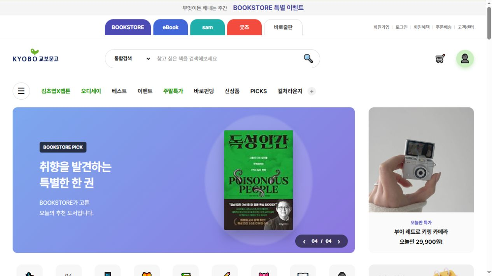

# BOOKSTORE | 도서 API 연동 온라인 서점

HTML·CSS·JavaScript로 온라인 서점의 메인 페이지와 도서 상세페이지를 구현한 개인 프로젝트입니다.

**Kakao 도서 검색 API로 불러온 데이터를 화면에 연결**하고, 추천 목록과 분류 탭, 도서별 상세 정보, 수량 선택 기능을 구현했습니다. 정적인 화면 구성에서 나아가 외부 데이터 요청과 응답 처리, 화면 갱신 과정을 경험하는 데 초점을 맞췄습니다.

- **프로젝트 유형:** 개인 웹 퍼블리싱·JavaScript 프로젝트
- **사용 기술:** HTML5 · CSS3 · JavaScript(ES6+) · Fetch API · Kakao 도서 검색 API · Git / GitHub
- **페이지:** 메인(`index.html`), 도서 상세(`sub.html`)
- **GitHub:** https://github.com/hyeran712/bookstore

## 홈페이지 바로가기

**[BOOKSTORE 홈페이지 열기 ↗](https://hyeran712.github.io/bookstore/)**

아래 메인 화면 이미지를 클릭해도 홈페이지로 이동합니다.

[](https://hyeran712.github.io/bookstore/)

## 프로젝트 소개

메인 페이지에서는 도서를 여러 주제와 분류로 탐색하고, 상세페이지에서는 선택한 도서의 정보를 확인할 수 있도록 구성했습니다.

- 메인 배너와 오늘의 선택
- 베스트셀러·MD 추천·출판사 추천·트렌드 추천·랭킹 영역
- CASTing 콘텐츠와 이벤트 영역
- 도서 표지·저자·출판사·가격·소개를 보여주는 상세페이지

추천·베스트셀러·랭킹 영역 중 지정 도서 목록을 사용하는 부분은 **직접 정한 제목으로 API를 검색해 구성한 전시용 목록**입니다. 실제 판매량 기반 순위를 제공하는 기능은 아닙니다.

## 주요 기능과 구현 방법

### 1. Kakao 도서 검색 API 연동

`fetch()`와 `async/await`를 사용해 도서 정보를 요청하고, 응답의 `documents` 데이터를 화면에 표시했습니다.

- 검색어를 `encodeURIComponent()`로 인코딩해 요청
- 표지·제목·저자·출판사·가격·출간일·책 소개 등 활용
- 응답 상태를 확인하고 요청 실패 시 오류 처리
- 여러 도서를 조회하는 목록에서 `Promise.all()`로 요청을 병렬 처리
- 개별 요청이 실패하거나 결과가 없는 도서는 목록에서 제외

### 2. 추천 도서와 분류 탭

API 요청 함수와 화면 출력 함수를 분리해, 영역별 데이터에 맞는 도서 카드를 렌더링했습니다.

- **오늘의 선택:** 주제별 검색 결과에서 최근 1년 이내 출간 도서를 선별하고 최신순 정렬
- **데이터 선별:** 출간일·표지가 없거나 제목에 지정한 제외 단어가 포함된 도서는 필터링
- **탭 전환:** 오늘의 선택, 베스트셀러, 랭킹에서 연결된 분류 탭을 누르면 도서 목록과 선택 표시 갱신
- **목록 출력:** 대표 도서와 보조 도서, 추천 카드, 번호가 있는 랭킹 카드 등 영역별 구성

### 3. 메인 배너 슬라이드

배너 4개를 순환하며 보여주고, 각 배너에 연결된 도서 표지를 API로 불러왔습니다.

- 4초 간격 자동 전환
- 이전·다음 버튼으로 수동 전환
- `01 / 04` 형식의 현재 위치 표시
- 배너 클릭 시 해당 도서 제목을 전달해 상세페이지로 이동

### 4. 도서별 상세 정보 연결

메인 배너에서 `sub.html?title=도서명` 형태로 이동하고, 상세페이지에서는 `URLSearchParams`로 제목을 읽어 API를 다시 조회합니다.

- 공백을 제거한 제목을 비교해 일치하는 도서를 우선 선택
- 표지·저자·출판사·출간일·ISBN·소개 출력
- 판매가가 있으면 판매가를 사용하고, 없으면 정가 사용
- 정가와 판매가로 할인율 계산, 판매가 기준 5% 포인트 표시
- 조회한 도서 제목에 맞춰 브라우저 탭 제목 갱신
- 검색 결과가 없거나 요청에 실패하면 안내 문구 표시

`기억의 무늬` 도서에는 별도로 준비한 상세 이미지를 표시하도록 구성했습니다.

### 5. 상세페이지 검색과 수량 선택

- 상세페이지 검색창에서 버튼 또는 Enter 키로 도서 검색
- 검색어가 비어 있으면 입력 안내 표시
- 수량 버튼으로 선택 수량 변경
- 최소 수량을 1개로 제한
- 장바구니·구매 버튼 클릭 시 안내창 표시

현재 장바구니·구매 버튼은 동작 확인용입니다. 상품 저장, 주문·결제, 수량에 따른 합계 금액 계산은 구현 범위에 포함되지 않습니다.

## 화면 구성과 스타일

- `common.css`에서 헤더·메뉴·푸터 등 공통 스타일 관리
- `main.css`와 `sub.css`로 페이지별 스타일 분리
- 메인 페이지는 PC 화면 중심으로 구성
- 공통 영역과 상세페이지 일부에 화면 너비별 미디어 쿼리 적용

전체 페이지의 모바일 최적화는 향후 개선 항목으로 두었습니다.

## 파일 구조

```text
├── index.html          # 메인 페이지
├── sub.html            # 도서 상세페이지
├── css/
│   ├── common.css      # 헤더·메뉴·푸터 공통 스타일
│   ├── main.css        # 메인 페이지 스타일
│   └── sub.css         # 상세페이지 스타일
├── js/
│   ├── api.js          # 도서 API 요청·데이터 선별
│   ├── render.js       # 메인 도서 목록 렌더링
│   ├── main.js         # 메인 초기화·배너·탭 전환
│   ├── sub.js          # 상세 조회·검색·수량 선택
│   └── detail.js       # 현재 비어 있는 파일
└── img/
    ├── logo.svg
    ├── casting/        # 콘텐츠 이미지
    ├── event/          # 이벤트 이미지
    ├── promo/          # 프로모션 이미지
    └── sub/            # 특정 도서 상세 이미지
```

## 실행 방법

1. 저장소를 내려받습니다.
2. VS Code에서 프로젝트 폴더를 엽니다.
3. Live Server 등 로컬 웹 서버로 `index.html`을 실행합니다.
4. 도서 데이터가 표시되지 않으면 API 인증 설정, 네트워크 상태와 브라우저 콘솔을 확인합니다.

별도의 패키지 설치나 빌드 과정은 없습니다. 도서 데이터 조회에는 인터넷 연결과 유효한 API 인증 설정이 필요합니다.

## 학습한 점

- **외부 데이터 연결:** API 응답을 화면에 필요한 정보로 가공하고 출력하는 흐름을 익혔습니다.
- **비동기 처리:** `async/await`, `Promise.all()`, `try/catch`로 요청과 오류를 다루는 방법을 경험했습니다.
- **데이터 선별:** 출간일·표지·제목 조건을 활용해 화면에 보여줄 도서를 고르는 과정을 구현했습니다.
- **페이지 간 정보 전달:** URL의 검색 매개변수로 도서 제목을 전달하고 상세페이지에서 활용했습니다.
- **역할별 코드 분리:** API 요청, 목록 렌더링, 페이지 동작을 파일로 나누어 관리했습니다.

## 향후 개선

- **인증 정보 관리:** 현재 브라우저에서 직접 호출하는 API 요청을 서버 또는 프록시로 분리
- **도서 식별 정확도:** 제목 대신 ISBN 등 식별자를 활용해 상세 도서 연결
- **탐색 흐름 확장:** 메인 검색과 각 도서 카드의 상세페이지 이동 연결
- **장바구니:** 선택 도서·수량 저장과 담은 목록 조회 구현
- **금액 연동:** 수량 변경에 따른 합계 금액 표시
- **로딩·오류 안내:** 메인 목록에 로딩 상태와 실패·빈 결과 안내 추가
- **반응형 개선:** 메인·상세페이지의 모바일 레이아웃 점검 및 보완
- **접근성 개선:** 배너 자동 재생 정지와 키보드 조작 지원
- **코드 정리:** 사용하지 않는 빈 파일과 중복 요청 로직 정리

---

학습 목적으로 제작한 비공식 온라인 서점 UI 프로젝트입니다. 도서 데이터는 Kakao 도서 검색 API를 활용했으며, 표지·콘텐츠 이미지 등 자료의 권리는 각 권리자에게 있습니다.

